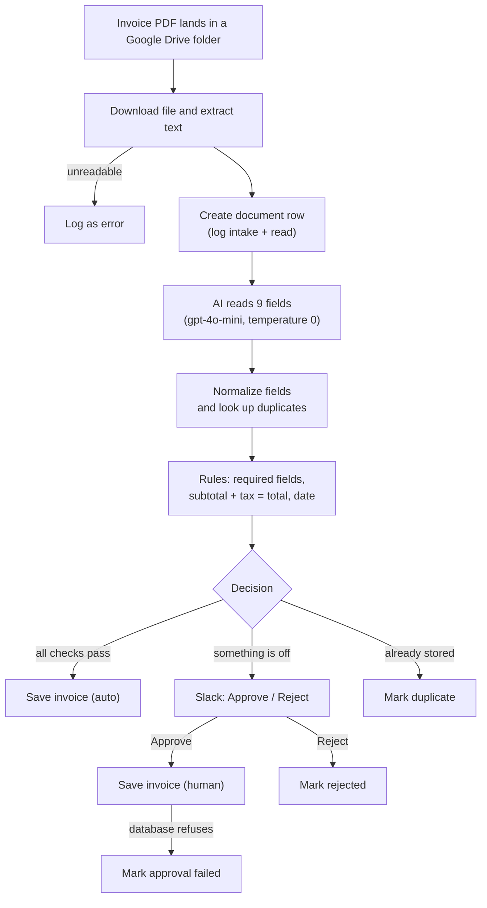

# Invoice Processing Pipeline

**AI extraction, rule-based validation, human approval and a PostgreSQL audit trail, built with n8n, OpenAI and Supabase.**

An invoice PDF dropped into a Google Drive folder is read automatically. An AI model copies nine fields out of it, plain business rules check them, and then the invoice goes one of three ways: stored automatically, sent to a person in Slack for Approve / Reject, or blocked as a duplicate. Every step is written to a database trail, so any decision can be traced afterwards.

<!-- Add the demo video link here after upload -->

---

## Why it is built this way

| Principle | What it means in practice |
|---|---|
| **The AI only reads** | The model copies printed values. It is told never to calculate, correct or guess. Every decision comes from auditable rules, not from the model. |
| **A person is never bypassed** | Anything suspicious waits in Slack. Nothing from that invoice is stored until someone clicks Approve. |
| **The database is the last line of defence** | Constraints refuse a blank invoice number, a bad status, or a second copy of the same invoice, even if the workflow has a bug. |
| **Everything leaves evidence** | Every file gets a `documents` row and `processing_events` rows. Rejected, duplicate and failed files are kept, not dropped. |

## How it works



### The checks

| Check | Rule |
|---|---|
| Required fields | supplier name, invoice number and invoice date are present, and total is greater than 0 |
| Math | `abs((subtotal + tax) - total) <= 0.01` (one cent of rounding is tolerated) |
| Date | the invoice date is present and not in the future |
| Duplicate | same **supplier** and same **invoice number**. Supplier is the tax ID when present, otherwise the lower-cased name. The number alone is never enough. |

### The outcomes

| Situation | Route | Document status | Row in `invoices`? |
|---|---|---|---|
| All checks pass | Save Invoice (Auto) | `auto_approved` | yes, `approval_path = auto` |
| A check fails, human approves | Slack, then Save Invoice (Human) | `approved_by_human` | yes, `approval_path = human` |
| A check fails, human rejects | Slack, then Mark Rejected | `rejected` | no |
| Same supplier + invoice number already stored | Mark Duplicate | `duplicate` | no |
| PDF cannot be read | Log Unreadable File | `error` | no |
| Human approved, but the database refused the row | Mark Approval Failed | `error` | no |

## Tech stack

| Layer | Tool |
|---|---|
| Orchestration | n8n (built on n8n Cloud) |
| Intake | Google Drive Trigger (polls the folder every minute) |
| Text extraction | n8n *Extract From File* (PDF) |
| AI extraction | n8n *Information Extractor* with OpenAI `gpt-4o-mini`, temperature 0 |
| Database | Supabase (PostgreSQL 15+), reached through the Session pooler |
| Human approval | Slack, n8n *Send and Wait for Response* (Approve / Reject) |

The workflow uses standard n8n nodes (Set, IF, Switch, Postgres) and **no Code nodes**.

## Complete setup guide

Follow the steps in order. Plan on about 45 minutes the first time. The workflow was built and tested on **n8n Cloud**; it uses only standard nodes, so self-hosted n8n works the same way.

### What you need before you start

| Need | Notes |
|---|---|
| n8n | n8n Cloud (tested) or self-hosted |
| Supabase account | the free plan is enough (this is the PostgreSQL database) |
| Google account | for the Drive folder that is watched |
| OpenAI API key | billing enabled; the workflow uses `gpt-4o-mini` |
| Slack workspace | permission to add a credential and post in one channel |

You will create **four n8n credentials**: Google Drive, Postgres (Supabase), OpenAI and Slack.

---

### Step 1. Create the Supabase project

Supabase is hosted PostgreSQL with a dashboard on top.

1. Sign in at [supabase.com](https://supabase.com) and click **New project**.
2. Choose an organization, name the project (for example `invoice-pipeline`) and choose a region close to your n8n instance.
3. Set a **strong database password** and save it in a password manager. You need it again in Step 4. If you lose it, reset it under *Project Settings → Database*.
4. Click **Create new project** and wait until the dashboard shows it as ready.

Free Supabase projects can be paused after a period of inactivity. If the workflow suddenly fails on every database node, open the dashboard and restore the project.

### Step 2. Create the tables in PostgreSQL

1. In the left menu of Supabase open **SQL Editor** and click **New query**.
2. Paste **all** of the SQL below and click **Run**. You should see a success message with no rows returned.

The script is safe to run again. It uses `IF NOT EXISTS` / `CREATE OR REPLACE`, so a second run changes nothing. PostgreSQL **15 or newer** is required, because the two views use `security_invoker`. Supabase projects meet this.

```sql
-- =====================================================================
-- Invoice Processing Pipeline - database schema (Supabase / PostgreSQL)
-- Run once in: Supabase > SQL Editor.  Safe to re-run (IF NOT EXISTS).
--
-- Three tables, three jobs:
--   documents          one row per file that arrives (even bad ones)
--   invoices           only ACCEPTED invoice data (auto or human-approved)
--   processing_events  evidence trail: one row per stage per document
-- =====================================================================

-- ---------------------------------------------------------------------
-- 1. documents
-- ---------------------------------------------------------------------
create table if not exists public.documents (
    id             uuid primary key default gen_random_uuid(),
    file_name      text        not null,
    file_hash      text        not null,                 -- Drive md5Checksum (or Drive file id); for traceability only
    source         text        not null default 'folder'
                   check (source in ('folder', 'email', 'upload')),
    received_at    timestamptz not null default now(),
    status         text        not null default 'received'
                   check (status in (
                       'received',           -- just arrived
                       'auto_approved',      -- every check passed
                       'needs_review',       -- waiting for / sent to a human
                       'approved_by_human',  -- human approved or corrected
                       'rejected',           -- human rejected
                       'duplicate',          -- blocked: already stored
                       'error'               -- technical failure
                   )),
    status_reason  text,                                 -- plain-English why
    extracted_json jsonb,                                -- raw reader output, untouched
    reviewed_by    text,
    reviewed_at    timestamptz,
    review_note    text,
    updated_at     timestamptz not null default now()
);

create index if not exists documents_status_idx    on public.documents (status);
create index if not exists documents_file_hash_idx on public.documents (file_hash);

-- ---------------------------------------------------------------------
-- 2. invoices  (accepted data only)
-- ---------------------------------------------------------------------
create table if not exists public.invoices (
    id               uuid primary key default gen_random_uuid(),
    document_id      uuid not null unique
                     references public.documents (id) on delete restrict,
    supplier_name    text not null check (btrim(supplier_name) <> ''),
    supplier_tax_id  text,
    invoice_number   text not null check (btrim(invoice_number) <> ''),
    invoice_date     date not null,
    due_date         date,
    currency         char(3) not null check (currency = upper(currency)),
    subtotal         numeric(14,2),
    tax              numeric(14,2),
    total            numeric(14,2) not null,
    approval_path    text not null check (approval_path in ('auto', 'human')),
    human_corrected  boolean not null default false,
    created_at       timestamptz not null default now(),

    -- Duplicate key = SUPPLIER + INVOICE NUMBER (never the number alone).
    -- Supplier is identified by tax id when present, else by normalised name.
    dedupe_key text generated always as (
        coalesce(nullif(btrim(supplier_tax_id), ''), lower(btrim(supplier_name)))
        || '|' || upper(btrim(invoice_number))
    ) stored
);

-- Safety net: even if the workflow's duplicate check ever fails,
-- the database refuses the second row.
create unique index if not exists invoices_dedupe_key_uniq on public.invoices (dedupe_key);

-- ---------------------------------------------------------------------
-- 3. processing_events  (the evidence trail)
-- ---------------------------------------------------------------------
create table if not exists public.processing_events (
    id          bigint generated always as identity primary key,
    document_id uuid not null references public.documents (id) on delete cascade,
    stage       text not null
                check (stage in ('intake', 'read', 'extract', 'validate',
                                 'approval', 'store', 'error')),
    outcome     text not null check (outcome in ('ok', 'warn', 'fail')),
    detail      jsonb,
    created_at  timestamptz not null default now()
);

create index if not exists processing_events_doc_idx
    on public.processing_events (document_id, created_at);

-- ---------------------------------------------------------------------
-- Helpers
-- ---------------------------------------------------------------------

-- Keep documents.updated_at honest.
-- clock_timestamp() (not now()) so it moves even inside one transaction.
create or replace function public.set_updated_at()
returns trigger language plpgsql as $$
begin
    new.updated_at := clock_timestamp();
    return new;
end $$;

drop trigger if exists documents_set_updated_at on public.documents;
create trigger documents_set_updated_at
    before update on public.documents
    for each row execute function public.set_updated_at();

-- One place that defines "is this a duplicate?" - the workflow calls this
-- instead of re-implementing the key logic. Same expression as dedupe_key.
create or replace function public.invoice_exists(
    p_tax_id text, p_name text, p_number text
) returns boolean
language sql stable as $$
    select exists (
        select 1 from public.invoices
        where dedupe_key =
            coalesce(nullif(btrim(p_tax_id), ''), lower(btrim(p_name)))
            || '|' || upper(btrim(p_number))
    );
$$;

-- ---------------------------------------------------------------------
-- Debug / demo views.  security_invoker so they respect table security.
-- ---------------------------------------------------------------------

-- "Follow one document down the pipeline": filter by document_id.
create or replace view public.v_document_trace
with (security_invoker = true) as
select d.id as document_id, d.file_name, d.status as document_status,
       e.created_at, e.stage, e.outcome, e.detail
from public.documents d
join public.processing_events e on e.document_id = d.id
order by d.received_at, e.created_at, e.id;

-- Counts per status - good for the demo video.
create or replace view public.v_status_summary
with (security_invoker = true) as
select status, count(*) as documents
from public.documents
group by status
order by status;

-- ---------------------------------------------------------------------
-- Security: block the public (anon) API key from touching any of this.
-- RLS on + no policies = only service_role / the postgres connection get in.
-- n8n uses one of those two, so it keeps working.
-- ---------------------------------------------------------------------
alter table public.documents         enable row level security;
alter table public.invoices          enable row level security;
alter table public.processing_events enable row level security;
```

(The same SQL is in [`sql/01_schema.sql`](sql/01_schema.sql).)

**What this creates**

| Object | Kind | Purpose |
|---|---|---|
| `documents` | table | one row per file that arrives, including bad ones. Holds the status (`received`, `auto_approved`, `needs_review`, `approved_by_human`, `rejected`, `duplicate`, `error`) and the AI's raw output |
| `invoices` | table | only accepted invoice data (auto-approved or human-approved). Money is `numeric(14,2)`, never floating point |
| `processing_events` | table | the evidence trail: one row per stage per document (`intake`, `read`, `extract`, `validate`, `approval`, `store`, `error`) with outcome `ok`, `warn` or `fail` |
| `invoice_exists()` | function | the single definition of "is this a duplicate?" that the workflow calls |
| `set_updated_at()` | function + trigger | keeps `documents.updated_at` accurate |
| `v_document_trace` | view | follow one document through the pipeline, in order |
| `v_status_summary` | view | number of documents per status |

**The rules the database enforces on its own**

- an invoice number or supplier name cannot be blank
- `status`, `stage`, `outcome`, `source` and `approval_path` only accept the listed values
- the currency must be a 3-letter upper-case code
- one invoice row per document (`document_id` is unique)
- **a duplicate is refused**: the generated `dedupe_key` is `supplier || '|' || invoice number` and has a unique index. The supplier is the tax ID when present, otherwise the lower-cased name. The number is trimmed and upper-cased. Same number from a different supplier is allowed.
- Row Level Security is enabled on all three tables with no policies, so the public Supabase API key cannot read or write them. n8n connects with the database password, which is not affected.

If you later see `relation "public.processing_events" does not exist`, this step was not run in the project that your n8n credential points to.

### Step 3. Test the database

Run [`sql/02_tests.sql`](sql/02_tests.sql) the same way (paste it into a new query and Run). It runs 13 checks inside a transaction that is **rolled back**, so it leaves no data behind. If the script finishes without an error, all 13 passed. A failure stops with a message that starts with `TEST FAILED:`. Some editor versions do not show the `PASS` notices, so rely on the absence of an error.

Then confirm security is on:

```sql
select relname as table_name, relrowsecurity as security_on
from pg_class
where relname in ('documents', 'invoices', 'processing_events');
```

All three rows must show `security_on = true`.

### Step 4. Get the Supabase connection details

1. Click **Connect** at the top of the Supabase dashboard (or open *Project Settings → Database*).
2. Choose the connection method **Session pooler**.
3. Note these values:

| Field | Value |
|---|---|
| Host | the pooler host shown in the panel, like `aws-0-<region>.pooler.supabase.com` |
| Port | `5432` |
| Database | `postgres` |
| User | `postgres.<your-project-ref>` (the project ref comes after the dot) |
| Password | the database password from Step 1 |

**Why the Session pooler:** the direct host (`db.<project-ref>.supabase.co`) is IPv6-only on the free plan, and n8n Cloud connects over IPv4, so it fails. The Session pooler accepts IPv4. Avoid the Transaction pooler (port 6543) for this workflow.

### Step 5. Create the four n8n credentials

In n8n open **Credentials → Create credential** for each:

**1. Postgres (Supabase)**

| n8n field | Value |
|---|---|
| Host | the Session pooler host from Step 4 |
| Database | `postgres` |
| User | `postgres.<your-project-ref>` |
| Password | your database password |
| Port | `5432` |
| SSL | leave the default first. If the test fails with an SSL error, set it to `Require` |

Click **Test**. It must report a successful connection. This credential is used by nine nodes.

**2. Google Drive OAuth2**

- On n8n Cloud, choose **Google Drive OAuth2 API** and sign in with Google.
- Self-hosted: create an OAuth client in Google Cloud Console, enable the **Google Drive API**, add n8n's OAuth redirect URL, then paste the client ID and secret into n8n.
- Used by two nodes: *Google Drive Trigger* and *Download File*.

**3. OpenAI**

- Create an API key on the OpenAI platform (billing must be enabled) and add it in the n8n **OpenAI** credential.
- Used by one node: *OpenAI Chat Model*.

**4. Slack**

- Create a Slack credential (on n8n Cloud, the OAuth2 sign-in is the simplest).
- The app must be allowed to post in your approvals channel. **Invite the app into that channel** (`/invite @your-app-name`), or the message fails.
- Used by one node: *Slack Approval*.

Never put any key or password in a file in this repository. They live only in n8n credentials and your password manager.

### Step 6. Import the workflow

1. In n8n open **Workflows → Add workflow**, then the menu (⋯) → **Import from file**.
2. Select [`n8n/invoice-pipeline.json`](n8n/invoice-pipeline.json).
3. The workflow opens with 20 working nodes and 5 sticky notes. The credential fields are empty because credentials are never stored in the file.

### Step 7. Connect your credentials, folder and channel

**a. Credentials on each node**

| Credential | Nodes |
|---|---|
| Google Drive | Google Drive Trigger, Download File |
| Postgres | Log Unreadable File, Create Document Row, Check Duplicate, Save Invoice (Auto), Mark Needs Review, Mark Duplicate, Save Invoice (Human), Mark Rejected, Mark Approval Failed |
| OpenAI | OpenAI Chat Model |
| Slack | Slack Approval |

**b. The Drive folder.** Create a folder in Google Drive (for example `invoices-inbox`). In *Google Drive Trigger*, pick it under *Folder to watch*. Keep the trigger event as **File Created**.

**c. The Slack channel.** In *Slack Approval*, pick the channel where approvals should appear.

Save the workflow.

### Step 8. Test one file at a time

Test with **one file in the Drive folder at a time**. The trigger's *Fetch Test Event* returns only the most recent file. Use any English, text-based invoice PDF (a scan or photo has no text layer).

1. Put one invoice PDF into the Drive folder.
2. Open *Google Drive Trigger* and click **Fetch Test Event**.
3. Click **Execute workflow** (keep the workflow unpublished).
4. Check which route it took, then delete the file from the folder before the next test.

| What the invoice looks like | Route you should see |
|---|---|
| Everything is present and the math is right | Save Invoice (Auto) |
| Subtotal + tax does not equal the total, the invoice number or date is missing, or the date is in the future | Slack message with the reason; Approve goes to Save Invoice (Human), Reject goes to Mark Rejected |
| The same supplier and invoice number as one already stored | Mark Duplicate |

Running the same file twice lands on *Duplicate* the second time. That is correct. After each run, check the database (see *Everyday queries* below). To start clean, run [`sql/03_reset_demo.sql`](sql/03_reset_demo.sql), which empties the three tables and keeps the structure:

```sql
truncate table public.processing_events, public.invoices, public.documents
    restart identity;
```

Never run the reset on data you want to keep.

### Step 9. Publish

When every route behaves in manual tests, **publish** the workflow (older n8n versions call this *Activate*).

- The Drive trigger now checks the folder **every minute** and starts a run for each **new** file. Files already in the folder are ignored.
- Drop one file at a time. Do not also run the same file manually while the workflow is published.
- A run waiting for a Slack decision shows as *Waiting* in **Executions** and finishes when someone clicks Approve or Reject.
- Rehearse once in published mode before relying on it: publish, upload an invoice that goes to review, click a button in Slack, and check the row in the database.
- To stop it, **unpublish**. It then stops checking the folder and stops calling OpenAI.

### Everyday queries

Run these in the Supabase SQL Editor.

```sql
-- every stored invoice, newest first
select supplier_name, invoice_number, invoice_date, currency,
       subtotal, tax, total, approval_path, created_at
from invoices order by created_at desc;

-- how many documents are in each state
select * from v_status_summary;

-- follow one document through the pipeline
select created_at, file_name, stage, outcome, detail
from v_document_trace
where file_name = 'your-invoice.pdf'
order by created_at;

-- what is waiting for a person
select file_name, status_reason, received_at
from documents where status = 'needs_review' order by received_at;

-- what went wrong technically
select file_name, status_reason, received_at
from documents where status = 'error' order by received_at desc;
```

### Using a different PostgreSQL host

Nothing in the SQL is specific to Supabase except the connection panel. On any **PostgreSQL 15+** server (Neon, RDS, self-hosted), run the schema and the tests with `psql -f`, then create the n8n Postgres credential with that server's host, port, database, user and password.

### More detail

Deeper guides: [Supabase](docs/01-supabase-setup.md) · [PostgreSQL data dictionary](docs/02-postgresql-guide.md) · [n8n node-by-node](docs/03-n8n-setup.md) · [troubleshooting](docs/05-troubleshooting.md) · [design decisions and roadmap](docs/06-design-decisions.md).

---

## Scope and limitations

Current scope: **English invoices that are text-based PDFs.**

Not included yet:
- scanned PDFs, photos and image files (needs OCR)
- Excel / CSV invoices
- email intake (only a Google Drive folder is watched)
- line-item extraction (only header fields and totals)
- multi-currency conversion (the currency is stored, never converted)

The roadmap is in [docs/06-design-decisions.md](docs/06-design-decisions.md).

## Security notes

- No credentials are stored in this repository. The workflow JSON contains no secrets, and you attach your own credentials after importing it.
- Row Level Security is enabled on all three tables, so the public Supabase API key cannot read or write them. n8n connects with the database password, which bypasses RLS.
- Every database query in the workflow uses **query parameters** (`$1`, `$2`, ...). File names and extracted values are never pasted into SQL text.

## Author

Built by **Zulfiqar**, an independent AI automation specialist working with n8n.

## License

MIT. See [LICENSE](LICENSE).
