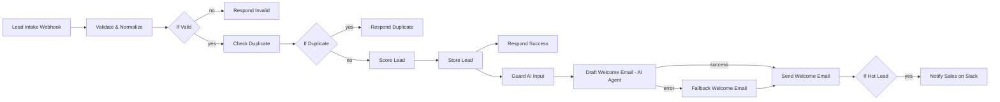
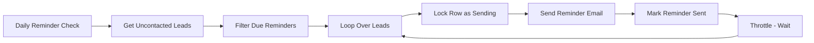
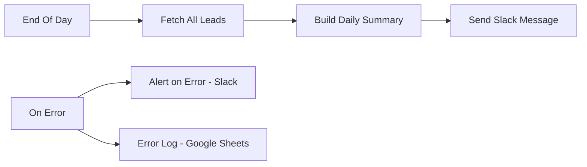

# Lead Management & Follow-up Automation (n8n)

An end-to-end n8n workflow that captures leads from a web form, validates and de-duplicates them, scores them, stores them in Google Sheets, sends an AI-drafted welcome email, alerts sales about hot leads in Slack, chases uncontacted leads with throttled reminders, and posts a daily summary. Errors are logged and alerted.

Built for small local-service businesses (restaurants, salons, clinics, agencies) that get leads from a website form but have no CRM process.

---

## What it does

| # | Flow | Trigger | Outcome |
|---|------|---------|---------|
| 1 | **Lead intake** | Webhook (POST) | Lead is validated, de-duplicated, scored, stored, welcomed by email, and hot leads are sent to sales on Slack |
| 2 | **Daily reminders** | Schedule (daily) | Leads not contacted after 3 days get a reminder email, sent one at a time with a pause between sends |
| 3 | **Daily summary** | Schedule (end of day) | Slack message with today's lead count split into hot / warm / cold |
| 4 | **Error handling** | Error Trigger | Failure is posted to Slack and appended to an Error Log sheet |

---

## Architecture







---

## Node-by-node reference

### Flow 1: Lead intake

| Node | Type | Role |
|------|------|------|
| **Lead Intake Webhook** | Webhook | Public POST endpoint your website form calls. Must be set to respond via a *Respond to Webhook* node. |
| **Validate & Normalize** | Code | Reads the body (`name`/`fullName`, `email`, `company`, `phone`, `message`/`notes`, `source`), trims and lowercases the email, requires name and a valid email format, rejects disposable-email domains and simple spam keywords, and produces sheet-safe copies (`*_sheet` fields) that are prefixed with `'` when they start with `=`, `+`, `-` or `@` to block Google Sheets formula injection. |
| **If Valid** | IF | Routes on `isValid`. Invalid leads go to *Respond Invalid*. |
| **Respond Invalid** | Respond to Webhook | Tells the form the submission was rejected. |
| **Check Duplicate** | Google Sheets (read) | Looks the lead's email up in the sheet. |
| **If Duplicate** | IF | If the email already exists, skip to *Respond Duplicate*. |
| **Respond Duplicate** | Respond to Webhook | Tells the form this lead already exists. Nothing is stored or emailed. |
| **Score Lead** | Code | Rule-based score (no AI, deterministic, no token cost). See scoring table below. |
| **Store Lead** | Google Sheets (append) | Saves the lead. Map the text columns to the `*_sheet` fields so formula injection stays blocked. |
| **Respond Success** | Respond to Webhook | Returns success to the form. |
| **Guard AI Input** | Code | Sits between the stored lead and the AI call; this is where input is cleaned or limited before it reaches the model. |
| **Draft Welcome Email** | AI Agent + OpenAI Chat Model | Drafts a short, personalised welcome email. Its error output routes to the fallback so a model failure never blocks the email. |
| **Fallback Welcome Email** | Code | Plain template email (`Hi {name}, thanks for reaching out...`) used when the AI step fails. |
| **Send Welcome Email** | Gmail (send) | Sends the AI draft or the fallback. |
| **If Hot Lead** | IF | Routes hot leads only. |
| **Notify Sales (Hot Lead)** | Slack (post message) | Alerts the sales channel with the lead's details. |

### Scoring (Score Lead)

| Signal | Points |
|--------|--------|
| Business email domain (not Gmail, Yahoo, Hotmail, Outlook, iCloud, AOL) | +30 |
| Company provided | +20 |
| Phone provided | +20 |
| Message longer than 40 characters | +20 |
| Message mentions demo, pricing, quote, buy, purchase, trial, urgent or asap | +20 |
| Source contains pricing, demo or contact-sales | +10 |

Total is capped at 100. **70+ = hot, 40-69 = warm, below 40 = cold.** New leads are written with `status: new`, `contacted: no`, `reminderSent: no`.

### Flow 2: Daily reminders

| Node | Type | Role |
|------|------|------|
| **Daily Reminder Check** | Schedule Trigger | Runs once a day. |
| **Get Uncontacted Leads** | Google Sheets (read) | Pulls leads that have not been contacted. |
| **Filter Due Reminders** | Code | Keeps only leads received 3 or more days ago (`DAYS = 3`, change it at the top of the node). Leads with a missing or unreadable `receivedAt` are skipped. |
| **Loop Over Leads** | Split In Batches | Processes one lead at a time. |
| **Lock Row as Sending** | Google Sheets (update) | Marks the row before sending so an overlapping or retried run does not email the same lead twice. |
| **Send Reminder Email** | Gmail (send) | Sends the reminder. |
| **Mark Reminder Sent** | Google Sheets (update) | Records that the reminder went out. |
| **Throttle (Wait)** | Wait | Pauses between sends to stay inside Gmail sending limits. Then loops back. |

### Flow 3: Daily summary

| Node | Type | Role |
|------|------|------|
| **End Of Day** | Schedule Trigger | Runs once at end of day. |
| **Fetch All Leads** | Google Sheets (read) | Reads every lead. |
| **Build Daily Summary** | Code | Filters to today's leads and counts hot / warm / cold. |
| **Send a message** | Slack | Posts the summary text. |

### Flow 4: Error handling

| Node | Type | Role |
|------|------|------|
| **On Error** | Error Trigger | Fires when a workflow execution fails. |
| **Alert on Error** | Slack | Posts the failure to a channel. |
| **Error Log** | Google Sheets (append) | Keeps a permanent record of failures. |

---

## Google Sheet structure

Create one spreadsheet with a `Leads` tab and an `Error Log` tab. Header names must match what the nodes read and write exactly, including capitalisation.

**Leads** columns written by the workflow:

`name`, `email`, `company`, `phone`, `message`, `source`, `domain`, `score`, `qualification`, `status`, `contacted`, `reminderSent`, `receivedAt`

`receivedAt` should be an ISO timestamp (for example `2026-10-14T09:30:00.000Z`) so the reminder filter can parse it reliably.

**Error Log** columns: timestamp, workflow name, failed node, error message (match them to your Error Log node mapping).

---

## Credentials you need

| Credential | Used by |
|-----------|---------|
| Google Sheets OAuth2 | Check Duplicate, Store Lead, Get Uncontacted Leads, Lock Row as Sending, Mark Reminder Sent, Fetch All Leads, Error Log |
| Gmail OAuth2 | Send Welcome Email, Send Reminder Email |
| Slack | Notify Sales, Alert on Error, Send a message |
| OpenAI API key | OpenAI Chat Model (Draft Welcome Email) |

Credentials are never stored in the exported JSON. You create them in your own n8n and reassign them after import.

---

## Setup and import order

Follow this order. Skipping ahead is the most common cause of "node has issues" errors.

1. **Create the Google Sheet** with the `Leads` and `Error Log` tabs and the headers above.
2. **Create the four credentials** in n8n (Google Sheets, Gmail, Slack, OpenAI).
3. **Import the workflow**: in n8n choose *Workflows → Import from File* and select `lead-management-follow-up-automation.json`.
4. **Reassign credentials** on every Google Sheets, Gmail, Slack and OpenAI node (red warning icons show which ones).
5. **Point every Google Sheets node** to your spreadsheet and the correct tab. Check that *Store Lead* maps its text columns to the `*_sheet` fields.
6. **Set the Slack channels** for *Notify Sales*, *Alert on Error* and the daily summary.
7. **Set the Error Workflow**: in the workflow's settings, select the workflow that contains the *On Error* trigger as the error workflow, otherwise failures will not reach it.
8. **Set the schedules** and your timezone on *Daily Reminder Check* and *End Of Day*.
9. **Test with the test webhook URL** before activating. Send these three cases:
   - a valid lead (expect a row, a welcome email, a success response)
   - the same email again (expect *Respond Duplicate*, no second row)
   - an invalid or disposable-domain lead (expect *Respond Invalid*)
10. **Test hot-lead alerting** with a lead that includes a business email, company, phone and the word "pricing" in the message.
11. **Activate** the workflow and switch your form to the production webhook URL.

### Example request

```bash
curl -X POST "https://YOUR-N8N-HOST/webhook/YOUR-PATH" \
  -H "Content-Type: application/json" \
  -d '{
    "name": "Sara Ahmed",
    "email": "sara@example-business.com",
    "company": "Example Co",
    "phone": "+966500000000",
    "message": "We would like a demo and pricing for our salon chain.",
    "source": "pricing-page"
  }'
```

---

## Security notes

- **Formula injection** is blocked at intake with sheet-safe field copies.
- **Disposable emails and basic spam phrases** are rejected before anything is stored.
- **Code nodes**: the workflow uses six Code nodes (Validate & Normalize, Score Lead, Guard AI Input, Fallback Welcome Email, Filter Due Reminders, Build Daily Summary). An n8n security scanner flags every Code node as "Code Execution Risk (High)" by node type. Each node was reviewed by hand: none uses `eval`, `Function`, dynamic `require`, outbound network calls, or environment variables.
- **Webhook**: the endpoint is public by design. Consider adding header authentication or a shared secret if the form is on a site you control.

---

## Tech stack

n8n, Google Sheets, Gmail, Slack, OpenAI.

## License

Released under the [MIT License](LICENSE). © 2026 Zulfiqar.
